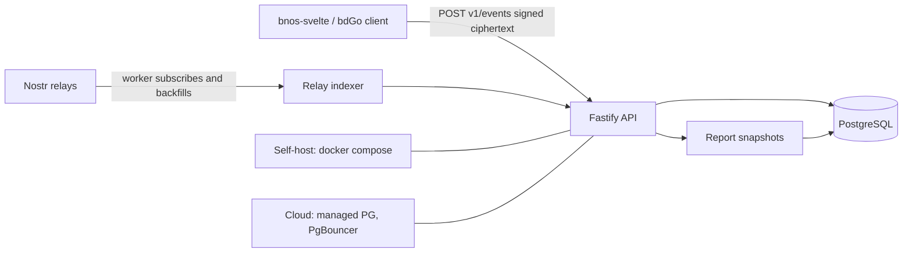

# bnos-data-service

Backend service for the BNOS commerce stack: durable backup, fast reporting, and
queryable projections for GLO/Nostr records produced by
[`bnos-svelte`](https://github.com/bitoslabs/bnos-svelte) and bdGo OS.

- Open source (MIT), self-hostable.
- Fastify 5 + PostgreSQL 16/17.
- Implements the **existing client protocol v1** (capabilities, signed-challenge
  auth, encrypted event ingest, status/backup reporting).
- Designed for two deployment modes from one image: **self-hosted** and
  **commercial cloud**.
- Deliberately lightweight: one service, one database, no Redis/Kafka/microservices
  in v1.

## Status

Implementation stage: **Phases 0–4** (client v1, relay backfill, snapshot reporting).

Implemented:

- `GET /v1/capabilities`
- invite + signed-challenge auth, refresh rotation, logout
- `POST /v1/events` with signature, kind, workspace, and envelope validation
- `GET /v1/status` with backup freshness
- PostgreSQL schema + migrations
- admin CLI for workspaces, invites, and relay subscriptions
- relay backfill worker (`pnpm worker`)
- `POST /v1/reports/snapshots` and `GET /v1/reports/summary`
- Dockerfile and `docker compose`

Not yet implemented: `report.snapshot` registration in `@bitos/bnos-core`,
client-side snapshot production, opt-in decryption, cloud operations.

See [`docs/ROADMAP.md`](docs/ROADMAP.md) for delivery phases.

## Run locally

Requires Node.js 22+ and PostgreSQL 16+.

```sh
pnpm install
cp .env.example .env          # set DATABASE_URL and SERVICE_AUDIENCE
# .env is loaded automatically; real environment variables take precedence.
pnpm migrate

# create a workspace and a one-time setup code
pnpm admin create-workspace --name "My Shop" --pubkey <owner-hex-pubkey>
pnpm admin create-invite --workspace <workspace-id>

pnpm dev                      # http://127.0.0.1:8080
```

Check the service:

```sh
curl http://127.0.0.1:8080/healthz
curl http://127.0.0.1:8080/v1/capabilities
```

Or run PostgreSQL and the API together:

```sh
docker compose up --build
```

### Relay backfill

Relay subscriptions are stored per workspace and are not configured by env.

```sh
pnpm admin add-relay --workspace <workspace-id> --url wss://relay.example.com
pnpm admin list-relays --workspace <workspace-id>
ENABLE_RELAY_INDEXER=true pnpm worker
```

The worker accepts an event only when its author is a current workspace member,
and any `organization` tag matches the workspace. An `organization` tag alone is
never authorization. Cursors advance only after durable ingest.

### Reporting

Clients post signed aggregate snapshots to `/v1/reports/snapshots`; summaries
come from `/v1/reports/summary`. Snapshot payloads are plaintext aggregates only
and are accepted only over authenticated HTTPS. A logical period is unique per
workspace, location, granularity, and currency, so corrections replace the prior
snapshot instead of double counting. Responses are labeled `snapshot: true` with
a watermark; missing periods are gaps.

Week/month rollups can be generated from day snapshots:

```sh
pnpm admin rollup --granularity week --workspace <workspace-id>
pnpm admin rollup --granularity month --workspace <workspace-id>
```

Rollups are flagged `derived`; a client-signed snapshot for the same logical
period always wins and is never overwritten by a later rollup. Summary responses
carry an `ETag`, so unchanged reports return `304`.

The invite code printed by the CLI is shown once. Enter the service URL and code
in the client under Settings → Data service.

## What problem it solves

The apps are local-first and Nostr-native. Relays are the source of truth; the
browser is the local cache and offline queue. Relays are good at replication but
poor at business queries: no aggregation, no joins, no indexed range scans over
history, no durable backup guarantees.

This service adds three capabilities **without becoming a dependency for
checkout**:

1. **Durable backup** of signed encrypted events, independent of relays.
2. **Fast reporting** over pre-aggregated, client-signed report snapshots.
3. **Relay backfill/indexing** so history can be reconstructed and mirrored into
   PostgreSQL.

Checkout, local reads, and relay sync must keep working when this service is
offline or disconnected.

## Architecture at a glance



Two ingest paths:

- **Client push** (authoritative, low latency): `POST /v1/events` — already
  implemented in the client.
- **Relay pull** (backfill and repair): a worker opens Nostr subscriptions,
  verifies and deduplicates events, and feeds the same ingest pipeline.

Nostr relays do not push to HTTP. "Data from relay to the API server" is
implemented as a server-side subscriber, not as relay webhooks.

## The core privacy tension

The client only uploads events whose content is a recognized encryption envelope
(`src/lib/data-service/queue.ts`). The service therefore normally holds
ciphertext and **cannot compute business reports from raw events**.

v1 resolves this with three cooperating pieces:

1. **Encrypted backup** of signed events (opaque to the server).
2. **Client-signed report snapshots** containing aggregates only (the console
   already computes these locally).
3. **Public-data mirror** for records that are intentionally plaintext.

Opt-in server-side decryption is a later, separately consented cloud feature.
See [`docs/REPORTING.md`](docs/REPORTING.md) and
[`docs/SECURITY.md`](docs/SECURITY.md).

## Commands

| Command                | Purpose                                     |
| ---------------------- | ------------------------------------------- |
| `pnpm dev`             | Start with watch                            |
| `pnpm build`           | Compile to `dist/`                          |
| `pnpm start`           | Run the built server                        |
| `pnpm migrate`         | Apply pending migrations                    |
| `pnpm admin <command>` | Workspace, invite, relay, and rollup administration |
| `pnpm worker`          | Run the relay backfill worker               |
| `pnpm test`            | Unit tests                                  |
| `pnpm typecheck`       | TypeScript check                            |

## Documentation

| Document                                       | Contents                                                                |
| ---------------------------------------------- | ----------------------------------------------------------------------- |
| [`docs/ARCHITECTURE.md`](docs/ARCHITECTURE.md) | Components, data flow, tech stack, repository layout                    |
| [`docs/PROTOCOL.md`](docs/PROTOCOL.md)         | Exact v1 HTTP contract required by the client, plus reporting extension |
| [`docs/DATA-MODEL.md`](docs/DATA-MODEL.md)     | PostgreSQL schema, indexes, partitioning, retention                     |
| [`docs/REPORTING.md`](docs/REPORTING.md)       | Snapshot model, rollups, query surface, privacy trade-offs              |
| [`docs/CONVENTIONS.md`](docs/CONVENTIONS.md)   | Clean code and SRP rules, layering, review checklist                    |
| [`docs/SECURITY.md`](docs/SECURITY.md)         | Threat model, auth, token handling, hardening checklist                 |
| [`docs/DEPLOYMENT.md`](docs/DEPLOYMENT.md)     | Self-host compose, cloud topology, configuration, operations            |
| [`docs/ROADMAP.md`](docs/ROADMAP.md)           | Phased milestones and acceptance criteria                               |

## Tech stack

| Layer       | Choice                                            |
| ----------- | ------------------------------------------------- |
| Runtime     | Node.js 22 LTS, TypeScript (strict, ESM)          |
| Framework   | Fastify 5                                         |
| Validation  | TypeBox + `@fastify/type-provider-typebox`        |
| Database    | PostgreSQL 16/17                                  |
| Query layer | `pg` + Kysely                                     |
| Migrations  | Forward-only runner using Kysely's schema builder |
| Nostr       | `nostr-tools` (`verifyEvent`, NIP-98 helpers)     |
| Auth        | Opaque random tokens, SHA-256 hashed at rest      |
| Tests       | Vitest + real PostgreSQL in CI                    |
| Packaging   | Multi-stage Docker image + `docker compose`       |

Excluded on purpose: Redis, Kafka, GraphQL, Prisma, NestJS, microservices.

## Related code

- Client protocol and state machine:
  [`bnos-svelte/src/lib/data-service/`](https://github.com/bitoslabs/bnos-svelte/tree/main/src/lib/data-service)
- Client integration plan:
  [`bnos-svelte/docs/BNOS_DATA_SERVICE_SETTINGS_PLAN.md`](https://github.com/bitoslabs/bnos-svelte/blob/main/docs/BNOS_DATA_SERVICE_SETTINGS_PLAN.md)
- Shared data model:
  [`packages/bnos-core`](https://github.com/bitoslabs/bnos-core)

## License

MIT. BNOS is a BitDigo project built on the foundation of the Bitcoin Network
Operations System.
