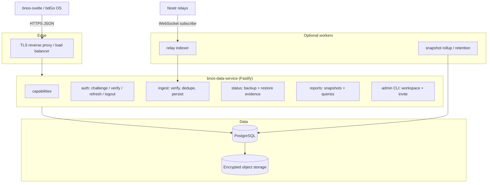
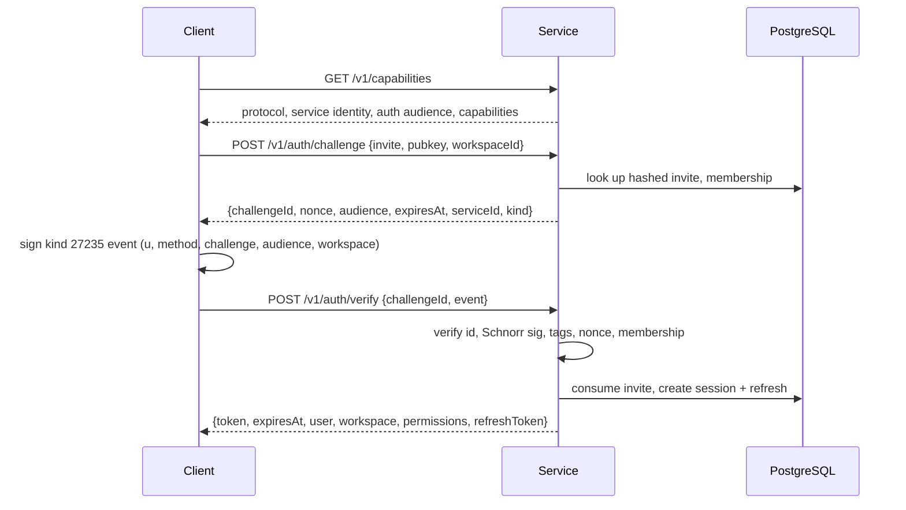
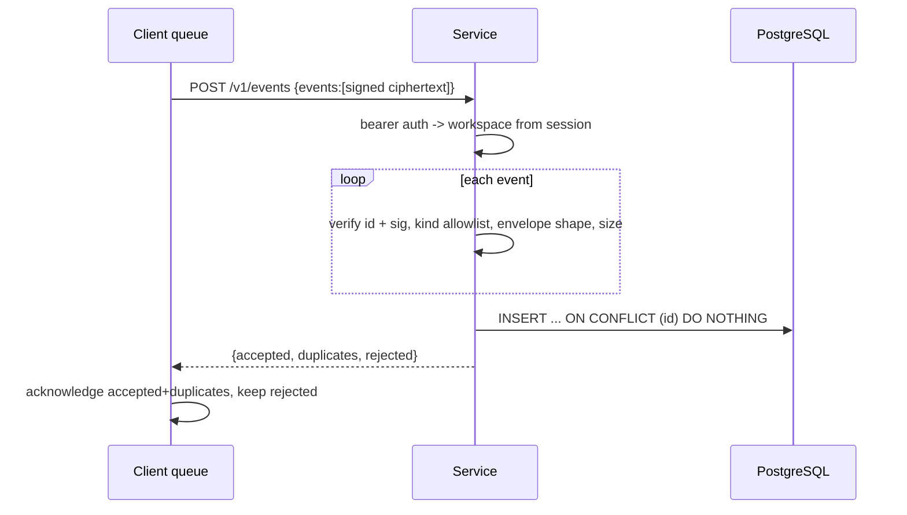
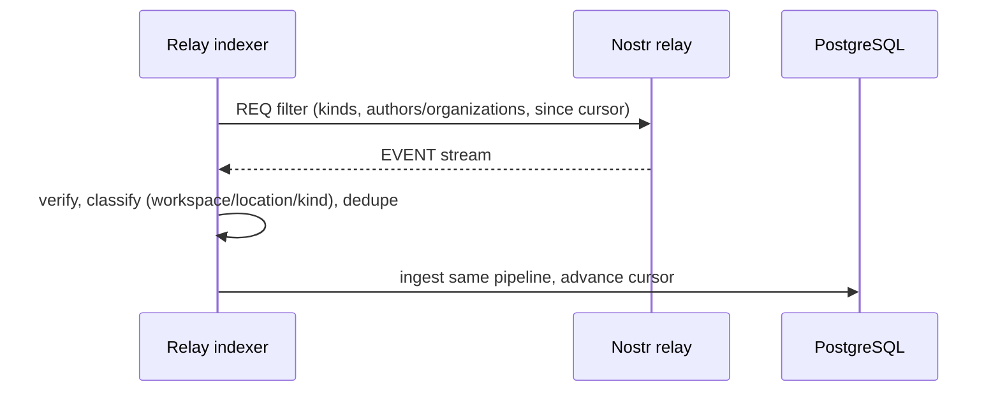
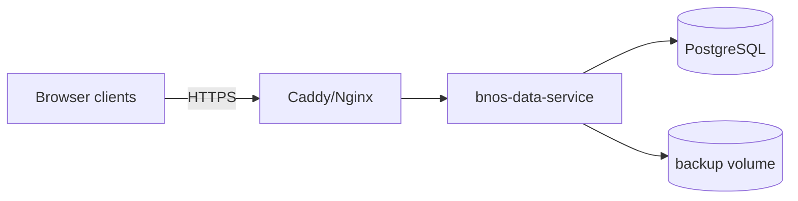
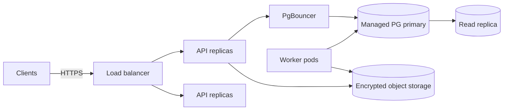

# Architecture

## 1. Context

BNOS clients (`bnos-svelte`, bdGo OS) are local-first and Nostr-native. Every
business record is a signed Nostr event (addressable GLO kind `30xxx`) whose
`content` is a versioned JSON envelope, encrypted for private data. Relays
replicate events but do not aggregate, join, or guarantee durability.

`bnos-data-service` is an **optional, non-blocking backend** that adds:

- durable encrypted backup,
- fast, pre-aggregated reporting,
- relay backfill/indexing into PostgreSQL.

It must never be required for checkout, POS, or local reads.

## 2. Design constraints

1. **Client protocol v1 is fixed.** The console already implements it under
   `src/lib/data-service/`. The server implements it exactly; protocol changes
   require coordination with bdGo OS.
2. **The server is untrusted with plaintext.** Private content is ciphertext.
   Reporting must be designed around that, not against it.
3. **Local-first is a contract.** Service outage must not affect transactions.
4. **One service, one database.** No Redis, Kafka, or service mesh in v1.
5. **Same image, two modes.** Self-hosted and cloud differ by configuration,
   not by a fork.
6. **Tenant safety.** Workspace isolation is enforced server-side from the
   session, never from client-supplied tags or body fields.

## 3. Components



| Component | Responsibility |
| --- | --- |
| API process | Stateless Fastify HTTP server: auth, ingest, status, reports |
| Ingest pipeline | Signature verification, envelope validation, idempotent persistence |
| Relay indexer | Outbound NIP-01 subscriptions, backfill, dedupe, same pipeline |
| Rollup scheduler | Snapshot aggregation, retention, backup freshness bookkeeping |
| PostgreSQL | Source of durable server state |
| Object storage | Optional encrypted logical backups / WAL archive (cloud) |

The API and workers share the same codebase and image. Workers are separate
processes started with a different command, enabled by env flags.

## 4. Request path

### 4.1 Client connect



### 4.2 Ingest



### 4.3 Relay backfill



## 5. Tech stack

| Layer | Choice | Rationale |
| --- | --- | --- |
| Runtime | Node.js 22 LTS | Matches client and deployment toolchain |
| Language | TypeScript strict, ESM | Shared types with client ecosystem |
| HTTP | Fastify 5 | Small dependency tree, schema-first, fast |
| Validation | TypeBox + type provider | Native JSON Schema, no duplicate validation layer |
| Database | PostgreSQL 16/17 | JSONB, partial indexes, partitioning, strong ops story |
| Query | `pg` + Kysely | Explicit SQL, type safety, no heavy ORM |
| Migrations | Small forward-only runner (Kysely schema builder) | One toolchain, reviewable, safe to re-run |
| Nostr | `nostr-tools` | Same library as the client; `verifyEvent` |
| Tokens | `crypto.randomBytes` + SHA-256 at rest | Opaque, revocable, no JWT denylist |
| Plugins | cors, helmet, rate-limit, under-pressure, compress, sensible | Standard hardening |
| Jobs | `jobs` table + in-process scheduler; `pg-boss` optional | No Redis |
| Logging | Fastify `pino` | Built in |
| Tests | Vitest + real PostgreSQL | Integration fidelity |
| Container | Multi-stage, `node:22-slim` / distroless | Small, reproducible |

## 6. Repository layout

Planned layout under `apps/bnos-data-service/`:

```text
docs/                      # this documentation set
src/
  server.ts                # process entry: build app, listen, register workers
  app.ts                   # buildApp(): plugin and route registration
  config.ts                # env parsing and validation (TypeBox)
  plugins/
    auth.ts                # bearer -> session, workspace scoping
    errors.ts              # typed error mapping to HTTP status codes
  routes/
    capabilities.ts        # GET  /v1/capabilities
    auth.ts                # POST /v1/auth/*
    events.ts              # POST /v1/events
    status.ts              # GET  /v1/status
    reports.ts             # GET  /v1/reports/* (protocol v1.1)
  domain/
    nostr.ts               # event verification, tag extraction
    envelope.ts            # encryption envelope validation
    glo.ts                 # GLO type/kind, scope, visibility helpers
    ids.ts                 # token/nonce/id generation and hashing
  db/
    types.ts               # Kysely database types
    migrations/            # ordered SQL/TS migrations
  ingest/
    pipeline.ts            # verify -> classify -> persist
    projections.ts         # optional plaintext projections
  reports/
    snapshots.ts           # snapshot validation and storage
    rollups.ts             # aggregation and retention
    queries.ts             # report read queries
  worker/
    relay-indexer.ts       # outbound Nostr subscriptions
    scheduler.ts           # rollups, retention, backup freshness
  admin/
    cli.ts                 # create workspace, issue invite, rotate secrets
test/
  unit/                    # pure functions: verification, envelope, tokens
  integration/             # HTTP + PostgreSQL via testcontainers
docker/
  Dockerfile
  compose.yaml
  Caddyfile.example
scripts/
  migrate.ts               # run Kysely migrations
```

## 7. Deployment topology

### Self-hosted



Single host or small VM. `docker compose up` starts the API, PostgreSQL, and an
optional TLS proxy. Migrations run on start or via an explicit release step.

### Cloud



Managed PostgreSQL, connection pooling, read replica for report queries,
encrypted WAL/backup archive, per-tenant quotas, metering, and observability.

## 8. Non-goals for v1

- Full NIP-01 WebSocket relay.
- Server-side decryption of private content.
- Billing and plan enforcement beyond simple quotas.
- Real-time push to clients.
- Cross-region active-active writes.
- GraphQL or RPC frameworks.

## 9. Key decisions

| Decision | Choice | Why |
| --- | --- | --- |
| Reporting on encrypted data | Client-signed aggregate snapshots | Preserves privacy, avoids server key custody |
| Relay integration | Server-side subscriber worker | Relays cannot push to HTTP; subscriber enables backfill |
| Auth tokens | Opaque, hashed at rest | Immediate revocation, no JWT key management |
| Tenant scoping | Session-derived workspace on every query | Prevent tag/body spoofing |
| Storage | One PostgreSQL | Lightweight, sufficient for small and medium tenants |
| Migrations | Small forward-only runner | Single Node toolchain, no extra binary in the image |
