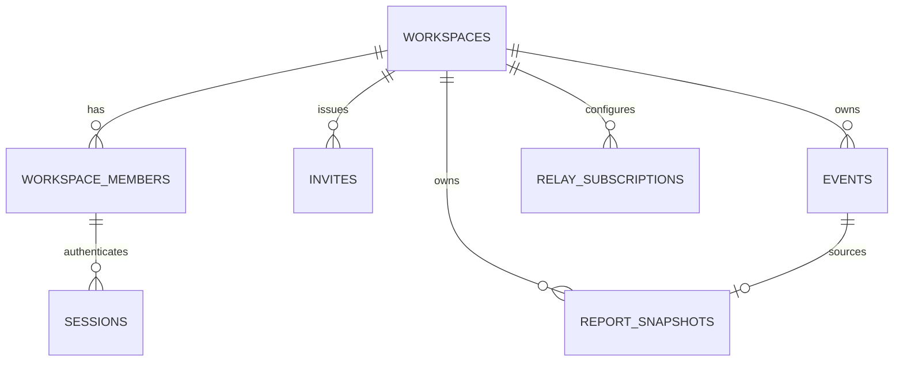

# Data model

PostgreSQL is the only durable server store in v1. This document is a reference
schema, not a final migration; migrations live in `src/db/migrations/`.

## 1. Entity overview



## 2. Conventions

- `workspace_id` is the GLO `organizationId` and the tenant key.
- `location_id` is the GLO `locationId` (branch); nullable.
- Public keys and event ids are lowercase hex, fixed width.
- Timestamps stored as `timestamptz` for operational columns; event
  `created_at` kept as `bigint` Unix seconds for Nostr fidelity and partitioning.
- Money is stored as integer **minor units** (`bigint`) plus a `char(3)`
  currency code. Never use floating point for money.
- Every tenant query filters by `workspace_id` derived from the session.
- Secret material is stored only as hashes (`bytea`, SHA-256).

## 3. Tenancy and auth

```sql
create table workspaces (
  id           text primary key,
  name         text not null,
  plan         text not null default 'self-hosted',
  status       text not null default 'active',
  created_at   timestamptz not null default now()
);

create table workspace_members (
  workspace_id text not null references workspaces(id) on delete cascade,
  pubkey       char(64) not null,
  role         text not null default 'staff',      -- owner | admin | staff
  permissions  text[] not null default '{}',          -- string array
  created_at   timestamptz not null default now(),
  revoked_at   timestamptz,
  primary key (workspace_id, pubkey)
);

create table invites (
  id           uuid primary key default gen_random_uuid(),
  workspace_id text not null references workspaces(id) on delete cascade,
  code_hash    bytea not null,
  pubkey       char(64),                           -- optional binding
  permissions  text[] not null default '{}',
  created_by   char(64),
  created_at   timestamptz not null default now(),
  expires_at   timestamptz not null,
  used_at      timestamptz,
  used_by      char(64)
);
create unique index invites_code_hash_idx on invites (code_hash);
create index invites_workspace_idx on invites (workspace_id, expires_at);

create table challenges (
  id           text primary key,                   -- challengeId
  nonce        text not null,
  workspace_id text not null references workspaces(id) on delete cascade,
  pubkey       char(64) not null,
  audience     text not null,
  created_at   timestamptz not null default now(),
  expires_at   timestamptz not null,
  used_at      timestamptz
);
create unique index challenges_nonce_idx on challenges (nonce);
create index challenges_expiry_idx on challenges (expires_at);

create table sessions (
  token_hash        bytea primary key,
  pubkey            char(64) not null,
  workspace_id      text not null references workspaces(id) on delete cascade,
  permissions       text[] not null default '{}',
  created_at        timestamptz not null default now(),
  expires_at        timestamptz not null,
  refresh_token_hash bytea unique,
  refresh_expires_at timestamptz,
  family_id         uuid not null default gen_random_uuid(),
  revoked_at        timestamptz
);
create index sessions_member_idx on sessions (workspace_id, pubkey);
create index sessions_refresh_expiry_idx on sessions (refresh_expires_at);
```

Notes:

- Access and refresh tokens are random 32-byte values returned once. Only
  `sha256(token)` is stored.
- Refresh rotation inserts a new row in the same `family_id`; presenting an old
  refresh token revokes the family.
- Invite codes are hashed; comparison is constant time.
- `permissions` is a PostgreSQL text array of strings; it maps directly to the
  session response.

## 4. Events

The raw signed event is the durable backup. Extracted columns enable indexing
without repeated JSONB parsing.

```sql
create table events (
  id             char(64) primary key,
  pubkey         char(64) not null,
  kind           integer not null,
  created_at     bigint not null,                 -- Unix seconds
  workspace_id   text not null,
  location_id    text,
  d_tag          text,
  address        text,                            -- kind:pubkey:d when addressable
  visibility     text,                            -- public | organization | private
  encrypted      boolean not null default false,
  envelope_scheme text,
  envelope_kid   text,
  content_bytes  integer not null,
  raw_event      jsonb not null,                  -- full signed event
  received_at    timestamptz not null default now()
) partition by range (created_at);
```

Create initial partitions and a helper for future months:

```sql
create table events_2026_11 partition of events
  for values from (1793491200) to (1796083200);   -- 2026-11-01 .. 2026-12-01
```

Indexes (created on the partitioned parent; PG propagates to partitions):

```sql
create index events_ws_kind_time_idx
  on events (workspace_id, kind, created_at desc);

create index events_ws_loc_kind_time_idx
  on events (workspace_id, location_id, kind, created_at desc);

create index events_ws_pubkey_kind_time_idx
  on events (workspace_id, pubkey, kind, created_at desc);

create index events_address_idx
  on events (workspace_id, address, created_at desc)
  where address is not null;

create index events_received_brin
  on events using brin (received_at);
```

Guidelines:

- Keep `raw_event` for fidelity and re-projection; it duplicates a few extracted
  fields, which is acceptable.
- `content_bytes` drives quota metering and abuse limits without parsing.
- Use `on conflict (id) do nothing` for idempotent ingest.
- Partition by `created_at` so business range scans prune. Drop or detach old
  partitions for retention.
- Do not decrypt `raw_event.content`. When plaintext is required for projections,
  use a separate, explicitly consented pipeline.

## 5. Backup state

The client shows backup freshness; keep the evidence explicit.

```sql
create table workspace_backup_state (
  workspace_id             text primary key references workspaces(id) on delete cascade,
  last_event_received_at   timestamptz,
  last_backup_at           timestamptz,
  last_verified_restore_at timestamptz,
  state                    text not null default 'unknown', -- unknown|current|stale|failed
  updated_at               timestamptz not null default now()
);
```

`last_event_received_at` is updated by ingest. `last_verified_restore_at` is set
only by an admin restore drill. Never set it from a successful ping.

## 6. Report snapshots

Client-signed aggregates. See [`REPORTING.md`](REPORTING.md).

```sql
create table report_snapshots (
  id             bigint generated always as identity primary key,
  workspace_id   text not null references workspaces(id) on delete cascade,
  location_id    text,
  source_event_id char(64) not null,
  type           text not null default 'report.snapshot',
  granularity    text not null,                   -- hour|day|week|month
  period_start   timestamptz not null,
  period_end     timestamptz not null,
  currency       char(3) not null,
  gross_minor    bigint,
  orders_count   integer,
  payload        jsonb not null,                  -- aggregates only
  raw_event      jsonb,                           -- signed source event, audit
  derived        boolean not null default false,  -- server rollup vs client event
  created_at     timestamptz not null default now()
);
create unique index report_snapshots_source_idx on report_snapshots (source_event_id);
-- One row per logical period so multiple devices converge.
create unique index report_snapshots_logical_idx
  on report_snapshots (workspace_id, (coalesce(location_id, '')), granularity, period_start, currency);
create index report_snapshots_lookup_idx
  on report_snapshots (workspace_id, granularity, period_start desc);
create index report_snapshots_location_idx
  on report_snapshots (workspace_id, location_id, granularity, period_start desc)
  where location_id is not null;
```

Rules:

- `payload` contains aggregates only; no customer identifiers, no free text, no
  line-item plaintext.
- `source_event_id` enforces idempotency.
- `currency` must be present; do not mix currencies in one snapshot without an
  explicit breakdown.

## 7. Optional plaintext projections

Only populate these for public events or after explicit opt-in decryption.
They are derived state and may be rebuilt from events.

```sql
create table orders (
  workspace_id  text not null,
  location_id   text,
  order_id      text not null,
  source_event  char(64) not null,
  occurred_at   timestamptz not null,
  status        text,
  currency      char(3) not null,
  total_minor   bigint not null,
  item_count    integer,
  customer_ref  text,                              -- pseudonymous only
  primary key (workspace_id, order_id)
);

create table order_items (
  workspace_id  text not null,
  order_id      text not null,
  line_no       integer not null,
  product_id    text,
  qty           numeric(18,4) not null,
  unit_minor    bigint not null,
  line_minor    bigint not null,
  primary key (workspace_id, order_id, line_no)
);

create table payments (
  workspace_id  text not null,
  pay_id        text not null,
  order_id      text,
  occurred_at   timestamptz not null,
  method        text not null,                     -- cash | lightning | card | other
  currency      char(3) not null,
  amount_minor  bigint not null,
  primary key (workspace_id, pay_id)
);
```

Add indexes matching your report ranges, typically
`(workspace_id, occurred_at)` and `(workspace_id, location_id, occurred_at)`.
Do not over-index; snapshots should serve most dashboards.

## 8. Relay backfill and operations

```sql
create table relay_subscriptions (
  id           bigint generated always as identity primary key,
  workspace_id text not null references workspaces(id) on delete cascade,
  relay_url    text not null,
  filter       jsonb not null,
  enabled      boolean not null default true,
  created_at   timestamptz not null default now()
);

create table relay_cursors (
  subscription_id bigint primary key references relay_subscriptions(id) on delete cascade,
  since           bigint not null default 0,       -- Unix seconds
  updated_at      timestamptz not null default now(),
  last_error      text,
  last_error_at   timestamptz
);

create table jobs (
  id         bigint generated always as identity primary key,
  kind       text not null,                        -- rollup | retention | restore-drill
  payload    jsonb not null default '{}'::jsonb,
  run_at     timestamptz not null default now(),
  attempts   integer not null default 0,
  locked_at  timestamptz,
  done_at    timestamptz
);
create index jobs_pending_idx on jobs (run_at) where done_at is null;

create table audit_log (
  id           bigint generated always as identity primary key,
  workspace_id text,
  actor_pubkey char(64),
  action       text not null,                      -- connect | invite | disconnect | restore
  detail       jsonb not null default '{}'::jsonb,
  created_at   timestamptz not null default now()
);
create index audit_log_workspace_idx on audit_log (workspace_id, created_at desc);
```

## 9. Cloud metering

```sql
create table workspace_usage (
  workspace_id   text not null,
  period         date not null,                    -- month bucket
  events_ingested bigint not null default 0,
  bytes_ingested  bigint not null default 0,
  report_queries  bigint not null default 0,
  primary key (workspace_id, period)
);
```

Increment atomically on ingest. Use for quotas and billing; never let quota
enforcement discard already accepted events or block local checkout.

## 10. Retention and partitioning

| Data | Default retention | Mechanism |
| --- | --- | --- |
| Raw events | Plan-dependent (e.g. 12 months self-host) | Drop/detach partitions |
| Report snapshots | Longer than raw events | `DELETE` by period or archive |
| Sessions/challenges | Short | Delete expired rows on a schedule |
| Audit log | Plan-dependent | Archive then delete |
| Backups | Plan-dependent | WAL/object storage policy |

Retention must be explicit and visible to the workspace owner. Deleting server
backups never deletes client-local data or relay events.

## 11. Row-level security (optional)

Application-level scoping is mandatory. As defense in depth in cloud, enable RLS:

```sql
alter table events enable row level security;
create policy events_tenant on events
  using (workspace_id = current_setting('app.workspace_id', true));
```

Set `app.workspace_id` per transaction from the authenticated session. RLS is
optional for self-host but recommended for cloud.
