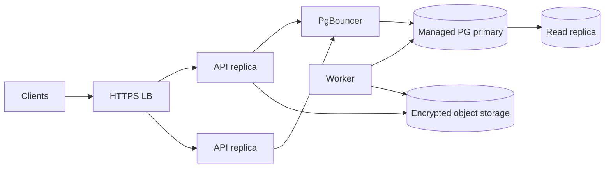

# Deployment

One image, two modes. Mode is selected by configuration, not by a code fork.

- `DEPLOYMENT_MODE=self-hosted` — single organization or small operator.
- `DEPLOYMENT_MODE=cloud` — managed multi-tenant offering.

## 1. Requirements

| Component | Self-host minimum | Cloud |
| --- | --- | --- |
| Node.js | 22 LTS (containerized) | same image |
| PostgreSQL | 16+ (bundled or external) | managed 16/17 |
| CPU/RAM | 1 vCPU / 1 GB | autoscaled replicas |
| Storage | disk for PG + backups | object storage + WAL archive |
| TLS | Caddy/Nginx | load balancer |

The client requires HTTPS for non-loopback hosts. HTTP is allowed only on
`localhost`/`127.0.0.1`/`::1` for development.

## 2. Configuration

All configuration is environment-based and validated at boot. See
[`.env.example`](../.env.example). Key groups:

| Variable | Purpose |
| --- | --- |
| `DEPLOYMENT_MODE` | `self-hosted` or `cloud` |
| `DATABASE_URL` | PostgreSQL connection string |
| `DATABASE_POOL_MAX` | Pool size |
| `HOST`, `PORT` | Listen address |
| `BASE_PATH` | Optional path prefix (e.g. `/bnos`) |
| `SERVICE_ID`, `SERVICE_NAME` | Capabilities identity |
| `SERVICE_AUDIENCE` | Stable audience string bound into challenges |
| `CORS_ORIGINS` | Comma-separated allowed app origins |
| `ACCESS_TOKEN_TTL_SECONDS` | Default 900 |
| `REFRESH_TOKEN_TTL_SECONDS` | Default 2592000 |
| `CHALLENGE_TTL_SECONDS` | Default 300 |
| `INVITE_TTL_SECONDS` | Default 86400 |
| `MAX_EVENT_BYTES`, `MAX_BATCH_SIZE` | Ingest limits (batch default 100) |
| `RATE_LIMIT_*` | Per IP/key limits |
| `ENABLE_REPORTING` | Enables snapshot + report routes |
| `ENABLE_RELAY_INDEXER` | Enables the relay worker |
| `ENABLE_SERVER_DECRYPTION` | Must remain `false` in v1 |
| `RELAY_URLS` | Comma-separated relays for backfill |
| `LOG_LEVEL` | pino level |
| `BACKUP_*` | Backup destination and schedule |

Never commit real secrets. Use your platform secret manager in cloud.

## 3. Self-hosted with Docker Compose

```yaml
services:
  db:
    image: postgres:17-alpine
    environment:
      POSTGRES_DB: bnos
      POSTGRES_USER: bnos
      POSTGRES_PASSWORD: ${POSTGRES_PASSWORD:?set me}
    volumes:
      - pgdata:/var/lib/postgresql/data
    healthcheck:
      test: ['CMD-SHELL', 'pg_isready -U bnos -d bnos']
      interval: 5s
      timeout: 5s
      retries: 10

  api:
    image: ghcr.io/bitoslabs/bnos-data-service:latest
    depends_on:
      db:
        condition: service_healthy
    environment:
      DEPLOYMENT_MODE: self-hosted
      DATABASE_URL: postgres://bnos:${POSTGRES_PASSWORD}@db:5432/bnos
      HOST: 0.0.0.0
      PORT: 8080
      SERVICE_AUDIENCE: https://data.example.com
      CORS_ORIGINS: https://app.bnos.space
    ports:
      - '127.0.0.1:8080:8080'
    command: ['node', 'dist/server.js']
    restart: unless-stopped

  # Optional TLS reverse proxy. Remove if you terminate TLS elsewhere.
  caddy:
    image: caddy:2-alpine
    depends_on: [api]
    ports:
      - '80:80'
      - '443:443'
    volumes:
      - ./docker/Caddyfile:/etc/caddy/Caddyfile:ro
      - caddy_data:/data
    restart: unless-stopped

volumes:
  pgdata:
  caddy_data:
```

`docker/Caddyfile`:

```caddyfile
data.example.com {
	encode zstd gzip
	reverse_proxy api:8080
}
```

Start:

```sh
docker compose up -d
docker compose exec api node dist/scripts/migrate.js
docker compose exec api node dist/admin/cli.js create-workspace --name "My Shop"
docker compose exec api node dist/admin/cli.js create-invite --workspace <id> --ttl 3600
```

The invite command prints the one-time setup code for the console
(Settings → Data service → self-hosted URL + setup code).

## 4. Path prefix

If the service is mounted under a prefix (for example `https://host/bnos`), then
clients resolve `v1/...` relative to that prefix, producing `/bnos/v1/...`.
Choose one approach and document it:

1. Set `BASE_PATH=/bnos` and register routes with that prefix, or
2. Configure the proxy to strip `/bnos` before forwarding.

The advertised `auth.audience` must be the exact value clients use, and the `u`
tag in the signed auth event must match the verify URL the server expects.

## 5. Migrations

- Migrations are ordered, forward-only, and run before the new release accepts
  traffic.
- Use Kysely's migrator (`node dist/scripts/migrate.js`) or run it as an init
  container.
- Never run destructive migrations in the same release as a code rollback.
- Create time partitions ahead of schedule (a scheduled job or migration).
- Test migrations against a restored production-shaped database.

## 6. Admin CLI

Minimum commands:

```text
create-workspace --name <name> [--id <organizationId>]
create-invite --workspace <id> [--pubkey <hex>] [--ttl <seconds>] [--permissions ...]
revoke-member --workspace <id> --pubkey <hex>
list-workspaces
restore-drill --workspace <id> --verified
```

The CLI connects directly to PostgreSQL using `DATABASE_URL`. Run it as a
one-off task with elevated but still least-privilege credentials; do not expose
admin actions over HTTP in v1.

## 7. Cloud topology



Cloud specifics:

- Stateless API replicas behind a load balancer.
- PgBouncer (transaction mode) to bound connections.
- Read replica for report queries when needed.
- WAL archiving to encrypted object storage; test restores.
- Per-tenant quotas and metering (`workspace_usage`).
- Centralized logs and metrics; request ids propagated.
- Rolling deploys; migrations as a separate step.
- No sticky sessions required.

## 8. Backups

Self-host:

- Nightly `pg_dump` (custom format) to an encrypted volume, plus WAL archiving if
  available.
- Retain at least 7 daily and 4 weekly snapshots for a small deployment.
- Run a restore drill monthly.

Cloud:

- Continuous WAL archiving with point-in-time recovery.
- Encrypted, cross-zone/object storage.
- Automated restore verification; set `last_verified_restore_at` only on success.

Backups must never contain organization keys (the service never receives them in
v1).

## 9. Scaling

| Symptom | Action |
| --- | --- |
| CPU-bound API | Add replicas |
| Connection pressure | Add PgBouncer, reduce pool size per replica |
| Ingest write pressure | Batch inserts, tune autovacuum, partition events |
| Report latency | Rollups, read replica, cache summary responses |
| Table bloat | Partition/drop old events, vacuum/analyze |
| Queue backlog in clients | Increase ingest throughput; clients retry safely |

Events are append-only and idempotent, so horizontal API scaling is safe.

## 10. Observability

- `GET /healthz` — process alive.
- `GET /readyz` — database reachable.
- Optional `GET /metrics` (Prometheus) behind config, never public.
- Structured logs with request id; redact secrets.
- Alerts: ingest error rate, auth failure spike, DB saturation, backup staleness,
  relay indexer lag.

## 11. Upgrade and rollback

1. Deploy new image to a canary or one replica.
2. Run migrations (backward compatible).
3. Shift traffic.
4. Watch error rate and latency.
5. Rollback the image if needed; migrations must remain compatible with the
   previous release.

## 12. Acceptance checklist

- [ ] Service starts with validated config and no plaintext secrets.
- [ ] Migrations run before traffic.
- [ ] `GET /v1/capabilities` reachable over HTTPS at the configured prefix.
- [ ] Admin CLI creates a workspace and a working one-time invite.
- [ ] Client can connect, ingest, and read status.
- [ ] Service outage does not affect client checkout or relay sync.
- [ ] Backups configured and a restore drill executed.
- [ ] `restoreStatus` advertised only after a verified restore.
