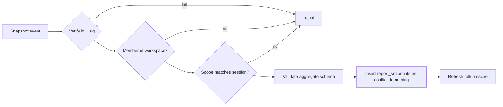

# Reporting

## 1. The privacy constraint

BNOS clients upload **encrypted** events (`AES-256-GCM`, organization key). The
server holds ciphertext and cannot compute business metrics from it. Any design
that promises fast reports must say how it obtains plaintext. This service uses a
privacy-preserving model instead of server key custody.

The client-side implementation guide (snapshot builder, deterministic ids,
encrypted relay copy, plaintext service push) lives in
[`bnos-svelte/docs/REPORT_SNAPSHOTS.md`](../../bnos-svelte/docs/REPORT_SNAPSHOTS.md).

## 2. Options considered

| Option | Server sees | Server can report | Risk |
| --- | --- | --- | --- |
| A. Opaque backup only | Ciphertext + metadata | No | Lowest |
| B. Client-signed aggregate snapshots | Aggregates | Yes (snapshots) | Low |
| C. Public/plaintext mirror | Public records | Yes | Low |
| D. Opt-in server decryption | Plaintext | Full SQL | Highest |

**Decision for v1: A + B + C.** Option D is a later, explicit, audited cloud
feature, never a silent default.

Reasons:

- The console already computes reports locally from plaintext
  (`src/routes/reports/+page.svelte`, `src/lib/dashboard/metrics.ts`). Reusing
  that computation avoids new trust assumptions.
- Snapshot aggregates are dramatically smaller than raw events and index
  extremely well.
- The server never needs the organization key, so a server breach does not
  expose customer, order, or payment details.

## 3. What a report snapshot is

A report snapshot is a small, **signed** Nostr event containing aggregates for a
fixed period and scope. It is:

- authored by a current workspace member,
- sent only to the data service over authenticated HTTPS,
- **not published to relays** (it may contain commercially sensitive totals),
- stored with a unique `source_event_id` for idempotency.

Proposed registry addition in `@bitos/bnos-core`:

```ts
NOSTR_KINDS.REPORT_SNAPSHOT = 30970;
GLO_KIND_BY_TYPE['report.snapshot'] = NOSTR_KINDS.REPORT_SNAPSHOT;
```

Until that ships, the service can accept the same payload shape carried on a
deployment-specific kind; the storage and verification logic are unchanged.

### 3.1 Event shape

```json
{
  "kind": 30970,
  "pubkey": "<member pubkey>",
  "created_at": 1760000000,
  "tags": [
    ["d", "org.bitos.glo:v1:report.snapshot:<id>"],
    ["organization", "<workspaceId>"],
    ["location", "<locationId>"],
    ["granularity", "day"],
    ["period-start", "1759968000"],
    ["period-end", "1760054400"],
    ["currency", "USD"],
    ["visibility", "organization"]
  ],
  "content": "<aggregate JSON>",
  "id": "...",
  "sig": "..."
}
```

### 3.2 Aggregate payload (v1)

Keep it small and non-identifying. Amounts are integer minor units.

```json
{
  "gross_minor": 123400,
  "net_minor": 110000,
  "tax_minor": 13400,
  "discount_minor": 5000,
  "refund_minor": 2000,
  "orders_count": 42,
  "items_count": 137,
  "avg_ticket_minor": 2938,
  "payments": { "cash": 80000, "lightning": 43400, "card": 0 },
  "order_status": { "completed": 40, "refunded": 2, "cancelled": 0 },
  "top_products": [
    { "product_id": "p_123", "qty": 30, "revenue_minor": 45000 }
  ]
}
```

Rules:

- No customer names, pubkeys, phone numbers, addresses, or free text.
- No line-item plaintext beyond product identifiers already public in the
  catalog. If product ids are sensitive for a tenant, allow a hashed id mode.
- One currency per snapshot. Multi-currency periods produce separate snapshots.
- Sums must be internally consistent; the server may validate basic invariants
  but must not claim to recompute from encrypted raw data.

### 3.3 When clients produce snapshots

- After closing a shift or on POS day close.
- On a schedule (hourly or daily) while online.
- On demand when the user opens reports and the latest snapshot is stale.
- At most one snapshot per `(workspace, location, granularity, period, currency)`.
  Re-publishing the same logical period replaces the prior row semantically;
  keep the newest by `created_at` and retain the raw event for audit.

## 4. Ingestion pipeline



- Verify canonical id, Schnorr signature, kind, tags.
- Require `organization` tag equals the authenticated workspace.
- `location` must belong to the workspace if provided.
- Validate `payload` against a TypeBox schema; reject unknown top-level keys in
  strict mode to prevent accidental PII.
- Enforce size limits (e.g. top products `<= 50`, payload `<= 64 KiB`).

## 5. Rollups

Raw snapshots are stored at the granularity the client sends (usually day).
Aggregate into week/month in `report_snapshots` or a separate rollup table.

Run the rollup job (schedule it with cron or a platform scheduler):

```sh
pnpm admin rollup --granularity week [--workspace <id>] [--from <unix>] [--to <unix>]
pnpm admin rollup --granularity month [--workspace <id>] [--from <unix>] [--to <unix>]
```

Generated rows are flagged `derived = true` and are safe to re-run. A
client-signed snapshot for the same logical period is never overwritten by a
rollup; the client value wins.

Aggregation query:

```sql
insert into report_snapshots
  (workspace_id, location_id, type, granularity, period_start, period_end,
   currency, gross_minor, orders_count, payload)
select
  workspace_id,
  location_id,
  'report.snapshot',
  'month',
  date_trunc('month', period_start)::timestamptz,
  (date_trunc('month', period_start) + interval '1 month')::timestamptz,
  currency,
  sum(gross_minor),
  sum(orders_count),
  jsonb_build_object(
    'net_minor',      sum((payload->>'net_minor')::bigint),
    'tax_minor',      sum((payload->>'tax_minor')::bigint),
    'discount_minor', sum((payload->>'discount_minor')::bigint),
    'refund_minor',   sum((payload->>'refund_minor')::bigint)
  )
from report_snapshots
where granularity = 'day'
group by workspace_id, location_id, currency, date_trunc('month', period_start);
```

Do not double-count when re-running: use a deterministic generated key or delete
the target bucket inside the same transaction before insert. Prefer
`delete ... where granularity='month' and period_start = X` followed by insert.

## 6. Query surface

### 6.1 Summary

`GET /v1/reports/summary`

| Query | Required | Notes |
| --- | --- | --- |
| `from` | yes | Unix seconds, inclusive |
| `to` | yes | Unix seconds, exclusive |
| `granularity` | yes | `hour` `day` `week` `month` |
| `location` | no | Branch scope |
| `currency` | no | Defaults to workspace default |

Response:

```json
{
  "snapshot": true,
  "generatedAt": 1760000000,
  "range": { "from": 1759968000, "to": 1760054400, "granularity": "day", "locationId": null },
  "currency": "USD",
  "buckets": [
    {
      "start": 1759968000,
      "end": 1760054400,
      "locationId": null,
      "currency": "USD",
      "grossMinor": 123400,
      "ordersCount": 42,
      "completeness": "snapshot",
      "payload": { "grossMinor": 123400, "ordersCount": 42 }
    }
  ],
  "watermark": 1759999000
}
```

### 6.2 Rules

- Tenant scope is always from the session.
- Missing periods are **gaps**. Do not fabricate zeros or imply completeness.
- `watermark` is the newest snapshot `created_at` the server holds; it does not
  prove every device uploaded.
- Amounts are integers in minor units; clients format them.
- Use keyset pagination for large bucket sets.
- Summary responses carry a weak `ETag` derived from the range, buckets,
  currency, and watermark. Matching `If-None-Match` requests return `304`.
  `Cache-Control` is `private, no-cache`; reports are tenant data.

### 6.3 Example query

```sql
select period_start, period_end, gross_minor, orders_count, currency, payload
from report_snapshots
where workspace_id = $1
  and granularity = $2
  and period_start >= $3
  and period_start <  $4
  and ($5::text is null or location_id = $5)
order by period_start asc
limit $6;
```

## 7. Freshness and status

- The service reports `backup.state` and snapshot `watermark` separately.
- `backup.state` reflects event ingest freshness (`current`/`stale`/`failed`).
- Report responses always include `snapshot: true` and a `watermark`.
- Never claim totals are authoritative; the client's local data remains the
  source of truth.

## 8. Optional server-side decryption (not v1)

If a future cloud plan offers full reporting:

1. Owner explicitly opts in and consents to key custody.
2. Workspace delivers a wrapped organization key to the service (NIP-44 grant or
   an equivalent secure channel), never a raw key in the browser or URL.
3. Keys are held in a KMS/HSM-backed store; decryption is logged and scoped.
4. Decrypted data is projected into plaintext tables with strict access control.
5. Retention and deletion are documented per plan; opt-out destroys server keys
   and derived projections.
6. An independent review is required before enabling this for any tenant.

This remains off by default and is not part of the v1 deliverable.

## 9. Acceptance criteria

- [ ] A client can upload a signed snapshot and it is stored idempotently.
- [ ] Non-members and cross-workspace snapshots are rejected.
- [ ] Summary queries return only the session workspace.
- [ ] Responses are labeled as snapshots with a watermark.
- [ ] No PII fields exist in the snapshot schema.
- [ ] Rollups are deterministic and safe to re-run.
- [ ] No decryption path exists in v1 code.
